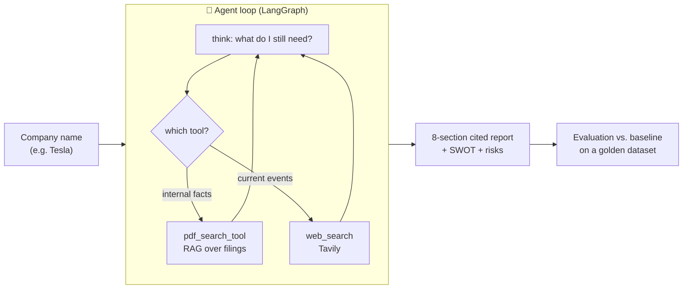
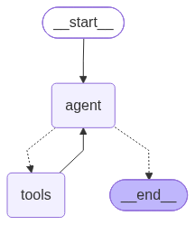
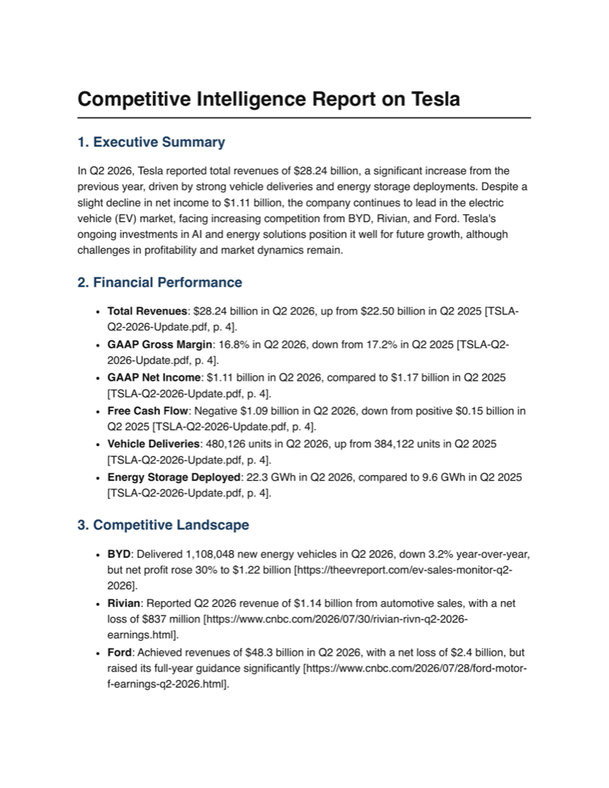

# Agentic Research Assistant — Cited Company Intelligence Reports

> An AI **agent** that turns a company name into a trustworthy, *fully cited* competitive-intelligence
> report in minutes — work that takes a human analyst **3–5 days**. It decides for itself when to read
> the company's filings and when to search the live web, and **every figure says where it came from**.

**JHU GenAI & Agentic AI — Project 3** · built in Google Colab · **both low-code and full-code implementations included**

### 📂 What to look at
- **[`research_agent_lowcode.ipynb`](research_agent_lowcode.ipynb)** / **[`research_agent_fullcode.ipynb`](research_agent_fullcode.ipynb)** — the executed notebooks (code + agent runs + evaluation). *GitHub renders them in your browser.*
- **[`Tesla_Competitive_Intelligence_Report.pdf`](Tesla_Competitive_Intelligence_Report.pdf)** — the generated, cited report (the deliverable).
- **[`Tesla_agent_trajectory.json`](Tesla_agent_trajectory.json)** — the agent's actual step-by-step tool-call log.

---

## 🧭 How it works

The agent runs a **think → search → read → search again → answer** loop, choosing between two tools
on its own, and stops only when it has enough *cited* evidence to write the report.

  
   The actual agent state graph: it loops between <b>agent</b> and <b>tools</b> until it's ready to answer.

**Its two tools**
- 🔎 `pdf_search_tool` — semantic (RAG) search over an internal corpus of filings & reports (Tesla 10-K/10-Q, Rivian 10-Q, IEA Global EV Outlook), using an in-memory vector store.
- 🌐 `web_search` — live web search via **Tavily**, for anything more recent than the filings.

## 🏆 Does the agent actually beat a simpler baseline?

The whole point of an agent is the extra complexity earning its keep. So both the **agent** and a
**naïve one-shot RAG baseline** were scored on a **golden dataset** of questions with known answers —
across PDF facts, live-web facts, hybrid, conflicting sources, and deliberately unanswerable ones.

| Metric | 🤖 Agent | Baseline (naïve RAG) |
|---|:---:|:---:|
| **Answer quality** (LLM judge, 0–1) | **0.81** | 0.56 |
| Strict pass rate | **0.54** | 0.42 |
| Cites a source **file** | **0.83** | 0.72 |
| Cites a **web URL** | **0.25** | 0.00 |
| Correct tool use | **0.92** | 0.75 |
| Evidence grounding | **0.78** | 0.61 |
| Refused the *unanswerable* | 1.00 | 1.00 |

**By question type** (answer-quality score) — the agent's edge is biggest exactly where a one-shot
baseline *can't compete*:

| Question type | 🤖 Agent | Baseline |
|---|:---:|:---:|
| Current web facts | **1.00** | 0.00 |
| Hybrid (docs **+** web) | **1.00** | 0.33 |
| Conflicting sources | **0.67** | 0.50 |
| PDF factual | **0.71** | 0.67 |
| Unanswerable (should refuse) | 1.00 | 1.00 |

> **Verdict:** 19 correct / 4 incorrect / 1 partial for the agent, vs. 12 / 9 / 3 for the baseline.
> The agent wins decisively on anything needing *current* information or *multiple* sources — and
> both systems correctly **refuse** questions the data can't answer.

*Honest note:* the LLM judge agreed with the strict deterministic grader on **83%** of answers.
A few "strict fails" were actually correct — e.g. the agent answered Tesla FY2025 revenue as
**$94.83B** where the reference was **$94,827M** (a legitimate rounding). The strict grader is
intentionally harsh; the judge catches that nuance.

## 📄 The deliverable: a cited Tesla intelligence report

  

> **Executive summary (excerpt):** *"In Q2 2026, Tesla reported total revenues of $28.24 billion…
> Despite a slight decline in net income to $1.11 billion, the company continues to lead in the EV
> market, facing increasing competition from BYD, Rivian, and Ford."*

Every number is traceable — e.g. *"Total Revenues: $28.24 billion … [TSLA-Q2-2026-Update.pdf, p. 4]"*
for filings, and live URLs for current events. The full report includes Financial Performance, a
Competitive Landscape, Recent Developments, a SWOT, Key Risks, and a Sources list.

## 🧰 Two implementations (both included)
- **Low-code** (`research_agent_lowcode.ipynb`) — builds the agent with LangGraph's higher-level
  agent construction.
- **Full-code** (`research_agent_fullcode.ipynb`) — wires the agent loop and tool-calling more
  explicitly.

Shipping both shows the same system at two levels of abstraction — rapid assembly *and* from-the-ground-up control.

## ⚙️ Engineering touches
- **Headless execution harnesses** (`run_lowcode.py`, `run_full.py`) — run a notebook end-to-end with
  `nbclient`, injecting a temporary retry/timeout patch so transient proxy failures (401s, timeouts)
  don't kill a long run, then cleaning the notebook before saving.

## Responsible-AI design
- **Citations required** — the agent is instructed to attribute every claim to a file+page or a URL.
- **Refuses the unanswerable** — scored 1.00 on questions the corpus/web can't support (no fabrication).
- **Conflict handling** — when sources disagree, it surfaces the conflict instead of picking silently.
- **Human-in-the-loop** — the output is a first-draft analyst report, not an automated decision.

## Tech stack
| Piece | Tool |
|---|---|
| Agent framework | **LangGraph** (+ LangChain tools) |
| LLM | OpenAI-compatible `gpt-4o-mini` (via gateway) |
| Retrieval | LangChain `InMemoryVectorStore` + OpenAI embeddings over the PDF corpus |
| Web search | **Tavily** (`langchain-tavily`) |
| PDF parsing | `pypdf` |
| Evaluation | golden-dataset grading + an LLM-as-judge |

## Running it yourself
1. `cp config.example.json config.json` and fill in your keys (OpenAI-compatible + Tavily) — **never commit `config.json`**.
2. `pip install -r requirements.txt`
3. Supply the document corpus in `data/` (Tesla/Rivian filings + the IEA EV Outlook). The original
   corpus (`data.zip`, ~31 MB of third-party PDFs) is **not** included; `data/golden_dataset.csv`
   (the evaluation set) *is*.
4. Open a notebook in Jupyter/Colab, **or** run it headlessly: `python run_lowcode.py`.

## Honest limitations / future work
- **Strict figure-matching** (`figure_ok` ≈ 0.39) is penalized by rounding; a tolerance band would help.
- **Web citation rate** (0.25) could be higher — require a URL whenever a web claim is made.
- **Latency** — the agent is ~2× slower than the baseline (more tool calls); fine for a research task, not for real-time.
- **Retrieval precision** — a reranking step would sharpen which chunks reach the model.
